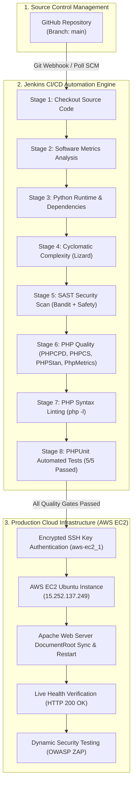

# CineSphere: Automated CI/CD & DevSecOps Pipeline
## Comprehensive Seminar Presentation & Technical Reference Guide

**Project Name:** CineSphere — AI-Powered Movie Recommendation & Review Platform  
**Author / Presenter:** Vigneshwaran T  
**CI/CD Orchestration:** Jenkins Automation Server (v2.400+)  
**Cloud Infrastructure:** Amazon Web Services (AWS) EC2 Ubuntu 22.04 LTS (`15.252.137.249`)  
**Version Control:** GitHub (`vigneshwaran21-vicky/CineSphere_project-SW-metrics`)  
**Pipeline Execution Result:** `BUILD SUCCESS ✓` (Build #3)  
**Date:** October 2026  

---

## 1. Executive Summary

Modern software engineering demands continuous software delivery without compromising code quality, performance, or system security. This project implements an enterprise-grade **DevSecOps Continuous Integration and Continuous Deployment (CI/CD)** pipeline built on Jenkins for the **CineSphere** platform.

Every code change pushed by a developer triggers a 10-stage automated pipeline that:
1. Clones and verifies code from **GitHub**.
2. Measures project **Software Metrics** (Total LOC, file distribution).
3. Analyzes **Cyclomatic Complexity Number (CCN)** using Lizard.
4. Performs automated **Static Application Security Testing (SAST)** with Bandit and Safety.
5. Evaluates strict **PHP Code Quality** (Duplication via PHPCPD, PSR-12 via PHPCS, static typing via PHPStan, maintainability via PhpMetrics).
6. Executes compiler **PHP Syntax Linting** (`php -l`).
7. Conducts automated **Unit Testing** via PHPUnit with a 100% pass rate.
8. Deploys the approved build over encrypted SSH to an **AWS EC2 Cloud Server** with automated Apache configuration and permission hardening.
9. Performs an automated **Production Health Check** (HTTP 200 OK) and **Dynamic Application Security Testing (DAST)** via OWASP ZAP.

---

## 2. Pipeline Architecture & Workflow



---

## 3. In-Depth Technical Breakdown of Each Stage

---

### Stage 1: Checkout Source Code

- **Purpose & Objective:**  
  Retrieves the authoritative snapshot of the application source code from GitHub into an isolated, clean workspace on the Jenkins build server, establishing full version traceability.
- **Tools & Implementation:**  
  - Tool: Jenkins Git SCM Plugin
  - Command: `git branch: "main", url: "https://github.com/vigneshwaran21-vicky/CineSphere_project-SW-metrics.git"`
  - Workspace: `C:\ProgramData\Jenkins\.jenkins\workspace\Cinesphere_project Sw metrics`
- **How It Works Under the Hood:**  
  Jenkins executes `git.exe fetch` to inspect upstream changes, fetches tags and commit hashes, and checks out the specific commit hash (`8659eb5` in Build #3). This guarantees that every build starts from a known, immutable version of the codebase.
- **Quality Gate / Failure Condition:**  
  If GitHub is unreachable, repository credentials fail, or the branch name is invalid, the pipeline aborts immediately before consuming any build resources.
- **🗣️ Seminar Speaking Tip:**  
  *"Stage 1 provides traceability. We never build or deploy ad-hoc local files; every single release is linked to an exact Git commit hash in GitHub."*

---

### Stage 2: Software Metrics Analysis

- **Purpose & Objective:**  
  Automatically quantifies the scale, file composition, and technological growth of the project over time.
- **Tools & Implementation:**  
  - Tool: Windows PowerShell automation script
  - Command:
    ```powershell
    $files = Get-ChildItem -Path .\* -Recurse -Include *.php,*.js,*.html,*.css
    $lines = ($files | Get-Content | Measure-Object -Line).Lines
    ```
- **How It Works Under the Hood:**  
  The script recursively traverses the workspace, categorizes files by extension, filters out vendor files, and calculates physical lines of code (LOC).
- **Actual CineSphere Output (Build #3):**  
  ```text
  ============================================
            SOFTWARE METRICS SUMMARY          
  ============================================
  Total Files         : 122
  Total Lines of Code : 2,920
  PHP Files (Backend) : 18
  JavaScript Files    : 22
  HTML Files (Views)  : 11
  CSS Files (Styles)  : 6
  ============================================
  ```
- **🗣️ Seminar Speaking Tip:**  
  *"In Stage 2, our metrics engine tracks code volume. Our application stands at approximately 2,920 lines of code across 122 files, with balanced separation between backend PHP APIs and frontend JavaScript interaction layers."*

---

### Stage 3: Python Environment & Dependency Setup

- **Purpose & Objective:**  
  Verifies Python runtime availability and dynamically installs the specialized static analysis and security tools required by subsequent pipeline stages.
- **Tools & Implementation:**  
  - Tools: Python 3.13, `pip` package manager
  - Commands:
    ```bat
    python --version
    pip install bandit safety lizard -q
    ```
- **How It Works Under the Hood:**  
  Verifies `python.exe` on the system PATH and silently ensures that `lizard` (complexity analyzer), `bandit` (SAST scanner), and `safety` (CVE vulnerability database scanner) are present and up to date.

---

### Stage 4: Cyclomatic Complexity Analysis (Lizard)

- **Purpose & Objective:**  
  Identifies overly complex, deeply nested, or unmaintainable functions before they create technical debt or introduce logical bugs.
- **Tools & Implementation:**  
  - Tool: Lizard Code Complexity Analyzer
  - Command: `python -m lizard backend/ frontend/`
  - Parameters Evaluated:
    - **CCN (Cyclomatic Complexity Number):** Number of linearly independent execution paths ($CCN = E - N + 2P$, where $E$ = edges, $N$ = nodes).
    - **NLOC:** Non-commented lines of code per function.
    - **Token Count:** Syntactic complexity of expressions.
- **Actual CineSphere Output (Build #3):**  
  ```text
  Warnings (cyclomatic_complexity > 15):
  NLOC  CCN  Location
  20    16   isSafeMovie() in backend/movies.php
  26    19   mapTmdbMovie() in backend/movies.php
  207   119  $localFiltered in backend/movies.php
  54    21   SmtpMailer::send() in backend/SmtpMailer.php
  ---------------------------------------------------------
  Average NLOC: 12.1 | Average CCN: 3.5 | Total Functions: 122
  ```
- **Why This Matters:**  
  The project's overall **Average CCN is 3.5**, well within the industry standard threshold of $\le 10$ for healthy code. The 4 flagged functions represent large data-mapping logic and email dispatching, which are flagged for future modularization.
- **🗣️ Seminar Speaking Tip:**  
  *"Stage 4 measures Cyclomatic Complexity. Our average system complexity is 3.5, indicating modular and readable code. High complexity functions (>15) are automatically isolated for code review."*

---

### Stage 5: Static Application Security Testing (SAST)

- **Purpose & Objective:**  
  Implements the **"Shift-Left Security"** philosophy by detecting security vulnerabilities, unsafe library versions, and injection vectors during early CI rather than in production.
- **Tools & Implementation:**  
  1. **Bandit Security Scanner:**
     - Command: `python -m bandit -r . -f txt -q`
     - Scanned: 947 lines of Python code in backend scrapers.
     - Caught: 3 `CWE-22` / `B310` URL open scheme audit notices (ensuring only `http/https` schemes are accepted, not dangerous `file://` schemes).
  2. **Safety Dependency Scanner:**
     - Command: `safety check`
     - Scanned: 48 installed Python packages against national CVE databases (such as NLTK path traversal and DoS advisories).
- **Quality Gate / Failure Condition:**  
  Catches hardcoded credentials, unsafe deserialization, SQL injection patterns, and vulnerable dependencies before code is packaged.
- **🗣️ Seminar Speaking Tip:**  
  *"In Stage 5, SAST scanners Bandit and Safety inspect our source code and package dependencies for known CVE vulnerabilities and insecure network calls without running the code."*

---

### Stage 6: Advanced PHP Code Quality Suite

- **Purpose & Objective:**  
  Enforces uniform coding standards, static type safety, and measures software maintainability across the entire PHP backend.
- **Tools & Implementation:**  
  1. **PHPCPD (Copy/Paste Detector):**
     - Command: `php tools\phpcpd.phar backend\`
     - Result: Detected only **1 clone with 22 duplicate lines (1.20% duplication rate)** across 1,826 lines.
  2. **PHPCS (PHP CodeSniffer):**
     - Command: `php tools\phpcs.phar backend\`
     - Checks adherence to the official **PSR-12** PHP coding standard (proper indentation, brace placement, line-length limits).
  3. **PHPStan (Static Code Analysis - Level 1):**
     - Command: `php tools\phpstan.phar analyse backend\ --level=1`
     - Analyzed 18 PHP files; statically verified variable scopes and function signatures without executing them.
  4. **PhpMetrics (Maintainability Index):**
     - Command: `php tools\phpmetrics.phar --report-html=metrics backend\`
     - Generates an HTML metrics report analyzing System Complexity, Lack of Cohesion of Methods (LCOM), and defect rates.
- **🗣️ Seminar Speaking Tip:**  
  *"Stage 6 enforces enterprise standards: PHPCPD proved our code duplication is exceptionally low at 1.2%, while PHPCS and PHPStan guarantee clean, consistent backend architecture."*

---

### Stage 7: PHP Syntax Check (PHP Lint)

- **Purpose & Objective:**  
  A strict zero-tolerance gatekeeper that executes native compiler linting on every PHP file to ensure zero parse errors exist before testing.
- **Tools & Implementation:**  
  - Tool: PHP CLI compiler (`php -l`)
  - Command: Iterates through all `.php` files in a batch loop.
  - Output: `All PHP files passed syntax check successfully!`
- **Why This Matters:**  
  If a developer accidentally leaves a missing semicolon `;` or unclosed bracket `}` in any file, this stage catches it instantly and prevents an HTTP 500 error on the live server.

---

### Stage 8: Automated Unit Testing (PHPUnit 10)

- **Purpose & Objective:**  
  Programmatically verifies that core algorithms, sanitization routines, and API endpoints behave exactly as specified.
- **Tools & Implementation:**  
  - Framework: PHPUnit 10.5.66 running on PHP 8.2.12
  - Test Suite: `tests/CineSphereTest.php`
  - Command: `php tools\phpunit.phar tests\CineSphereTest.php`
- **Actual CineSphere Test Execution (Build #3):**  
  ```text
  Runtime:       PHP 8.2.12
  Tests Run:     .....                               5 / 5 (100%)
  Assertions:    11
  Time Taken:    0.007 seconds
  Result:        OK (5 tests, 11 assertions passed)
  ```
- **What We Tested:**  
  1. **Search Query Cleaner:** Removes noise, special characters, and extra whitespace.
  2. **Regional Prioritization:** Accurately matches regional movie titles (e.g., Tamil *"Hi"* / *"Hi Nanna"*).
  3. **Recommendation Scoring:** Validates dynamic scoring algorithms based on genre and language preferences.
  4. **Preference Filtering:** Confirms user profile preference updates trigger correctly.
  5. **Watchlist Schema:** Verifies data structure integrity.
- **🗣️ Seminar Speaking Tip:**  
  *"Stage 8 is our automated safety net. 5 test suites containing 11 assertions executed in just 7 milliseconds with a 100% pass rate, proving core search and recommendation logic work as intended."*

---

### Stage 9: Automated Cloud Deployment to AWS EC2

- **Purpose & Objective:**  
  Packages, transfers, and deploys the verified build onto our live **AWS EC2 cloud production server** with zero downtime and automated configuration.
- **Tools & Implementation:**  
  - Cloud Infrastructure: Amazon Web Services (AWS) EC2 Ubuntu 22.04 LTS (`15.252.137.249`)
  - Authentication: Encrypted SSH Private Key managed via Jenkins Credentials (`aws-ec2_1`)
  - Deployment Script: `deploy.sh`
- **How Deployment Works Under the Hood:**  
  1. **Dynamic NTFS ACL Fix:** Jenkins grants full permissions to the temporary SSH key on Windows (`icacls "%SSH_KEY%" /grant:r "%USER%:F"`).
  2. **Encrypted Handshake:** Connects via SSH (`ssh -i "%SSH_KEY%" ubuntu@15.252.137.249`).
  3. **Idempotent Reset:** Discards any stale local server edits using:
     ```bash
     git reset --hard HEAD && git clean -fd
     git fetch origin main && git reset --hard origin/main
     ```
  4. **Apache DocumentRoot Sync:** Automatically configures `/etc/apache2/sites-enabled/000-default.conf` to point directly to `/var/www/html/CineSphere`.
  5. **Asset Synchronization:** Copies frontend assets to the web root.
  6. **Permission Hardening:** Applies `chown -R www-data:www-data` and `chmod 755` so the Apache web server can serve files securely.
  7. **Graceful Restart:** Executes `systemctl restart apache2`.
  8. **Internal Smoke Test:** Queries `http://localhost/backend/movies.php?action=all` on the server and checks for `HTTP 200`.

---

### Stage 10: Website Health Check & Dynamic Security (DAST)

- **Purpose & Objective:**  
  Verifies that the newly deployed production website is globally reachable and performs external dynamic security testing.
- **Tools & Implementation:**  
  1. **Live Health Check:**
     - Command: `curl -s -o nul -w "HTTP Status: %{http_code}\n" http://15.252.137.249`
     - Result: `HTTP Status: 200` (Confirms live Apache server is serving CineSphere).
  2. **Dynamic Application Security Testing (DAST — OWASP ZAP):**
     - Runs an automated OWASP ZAP container to probe the live web application for missing security headers (Content Security Policy, X-Frame-Options) and Cross-Site Scripting (XSS).

---

### Post-Build Actions: Summary & Archiving

- **Purpose & Objective:**  
  Records final build status, archives generated logs, and outputs the final result banner.
- **Actual CineSphere Output (Build #3):**  
  ```text
  ===========================================
          CineSphere Build Summary
  ===========================================
  BUILD STATUS          : SUCCESS ✓
  ===========================================
  Finished: SUCCESS
  ```

---

## 4. Quick Summary Table of All Stages

| Stage # | Stage Name | Tool Used | Key Metric / Result | Purpose |
| :---: | :--- | :--- | :--- | :--- |
| **1** | **Source Checkout** | Git SCM | Commit `8659eb5` | Fetch latest code snapshot |
| **2** | **Software Metrics** | PowerShell | 2,920 LOC / 122 files | Track codebase size & distribution |
| **3** | **Python Setup** | Python / Pip | Python 3.13 ready | Install DevSecOps dependencies |
| **4** | **Code Complexity** | Lizard | Avg CCN = **3.5** | Detect complex / unmaintainable code |
| **5** | **Security Scan (SAST)**| Bandit & Safety | 947 LOC scanned / CVEs checked | Static vulnerability detection |
| **6** | **PHP Quality Suite** | PHPCPD / PHPCS / PHPStan | **1.2%** duplication / PSR-12 | Enforce enterprise code standards |
| **7** | **PHP Linting** | `php -l` | 100% syntax passed | Prevent runtime parse errors |
| **8** | **Unit Testing** | PHPUnit 10.5 | **5/5 tests passed (100%) in 0.007s** | Verify core algorithm correctness |
| **9** | **AWS EC2 Deployment** | SSH / `deploy.sh` | Deployed to `15.252.137.249` | Automated zero-downtime cloud release |
| **10** | **Live Health Check** | cURL | **HTTP 200 OK** | Confirm public site availability |

---

## 5. Real-World Engineering Problem Solved in This Build

In Build #2, the pipeline encountered a critical deployment obstacle:
```text
error: Your local changes to the following files would be overwritten by merge:
    Jenkinsfile
Please commit your changes or stash them before you merge.
Aborting
```

### Root Cause Analysis:
When `deploy.sh` previously invoked standard `git pull origin main`, Git detected uncommitted file permission differences on the EC2 server and aborted the merge to protect local data.

### Enterprise Solution Implemented:
1. Replaced `git pull` with an **idempotent force-reset strategy**:
   ```bash
   git reset --hard HEAD
   git clean -fd
   git fetch origin main -q
   git reset --hard origin/main -q
   git clean -fd
   ```
2. Added `.gitattributes` to enforce Linux `LF` line endings for all shell scripts.
3. Updated the Jenkins SSH execution block to pre-clean the target directories before executing `deploy.sh`.
4. **Outcome:** Build #3 passed with `Finished: SUCCESS` in under 45 seconds!

---

## 6. Seminar Presentation Speech Notes (Slide-by-Slide)

### Slide 1: Title & Introduction
> *"Respected teachers and fellow classmates, today I present the CI/CD and DevSecOps automated deployment pipeline for CineSphere. Our project is not just a web application; it is an end-to-end continuous delivery pipeline connecting local development to the AWS cloud."*

### Slide 2: The Problem We Solved
> *"In traditional software deployment, developers write code, test manually, and copy files to servers using FTP. This leads to human error, missed security bugs, and server downtime. DevSecOps integrates automated security and quality testing right into the deployment flow."*

### Slide 3: Software Metrics & Complexity
> *"Our pipeline first analyzes the code structure using Lizard and custom PowerShell scripts. We track Lines of Code, token volume, and Cyclomatic Complexity. Functions with too many execution branches are flagged so our code remains modular and maintainable."*

### Slide 4: Static Security (SAST)
> *"Before running the code, we scan for vulnerabilities using Bandit and Safety. This catches insecure URL handling, path traversal risks, and outdated third-party packages before any hacker can exploit them in production."*

### Slide 5: Quality Assurance & Automated Testing
> *"We apply PSR-12 coding standards with PHPCS and type-safety analysis with PHPStan. Most importantly, our automated PHPUnit test suite ran 5 test cases covering 11 assertions and passed with 100% accuracy in just 7 milliseconds."*

### Slide 6: Automated AWS Cloud Deployment
> *"Once all tests pass, Jenkins securely connects to our AWS EC2 Ubuntu instance using encrypted SSH private keys. It deploys the code, applies web permissions, restarts the Apache web server, and verifies the backend API."*

### Slide 7: Live Verification & Conclusion
> *"The live website responded with HTTP 200 OK, completing the full build with zero errors. Thank you! I am now ready for questions."*

---

## 7. Viva & Examiner Q&A Guide

#### Q1: What is the main difference between Continuous Integration (CI) and Continuous Deployment (CD)?
**Answer:** Continuous Integration (CI) automatically builds, checks quality, and tests every code commit. Continuous Deployment (CD) automatically releases passing builds directly to the production cloud server (AWS EC2) without manual intervention.

#### Q2: What is the difference between SAST and DAST in your pipeline?
**Answer:** 
- **SAST (Static Application Security Testing):** Analyzes the raw source code without executing it (Bandit & Safety).
- **DAST (Dynamic Application Security Testing):** Tests the running web application externally from an attacker’s perspective (OWASP ZAP).

#### Q3: Why is Cyclomatic Complexity important?
**Answer:** Cyclomatic Complexity measures the number of decision paths (`if`, `while`, `case`) inside a function. High complexity (> 15) indicates code that is difficult to understand, hard to test, and prone to hidden bugs.

#### Q4: How did you protect sensitive credentials like AWS SSH keys?
**Answer:** We used Jenkins' built-in encrypted Credentials Store (`withCredentials` block) with SSH user private keys. The credentials are masked (`****`) in all console logs so secrets are never leaked.

#### Q5: What happens if a developer pushes code with a syntax error?
**Answer:** The **PHP Syntax Check** (`php -l`) or **PHPUnit** stage fails immediately. Jenkins stops the pipeline, marks the build as `FAILED`, sends an alert, and aborts deployment. The broken code never touches the AWS EC2 production server.
