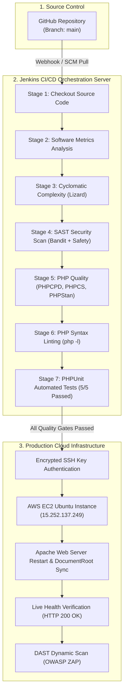

# CineSphere: Automated CI/CD & DevSecOps Pipeline
## Seminar Presentation & Technical Documentation

**Project Name:** CineSphere — AI-Powered Movie Recommendation & Review Platform  
**Presenter:** Vigneshwaran T  
**CI/CD Engine:** Jenkins v2.400+  
**Deployment Target:** Amazon Web Services (AWS) EC2 Ubuntu Cloud Server  
**Source Code Management:** GitHub (`vigneshwaran21-vicky/CineSphere_project-SW-metrics`)  
**Pipeline Status:** `BUILD SUCCESS ✓` (Build #3)  

---

## 1. Executive Summary

Modern software engineering demands high-velocity deployment without sacrificing security or software quality. This project demonstrates an enterprise-grade **DevSecOps Continuous Integration & Continuous Deployment (CI/CD)** pipeline built with Jenkins for the **CineSphere** web application.

Whenever code changes are committed and pushed to GitHub, Jenkins automatically:
1. Clones and inspects the codebase.
2. Computes comprehensive **Software Metrics** (LOC, file breakdown).
3. Analyzes **Cyclomatic Complexity Number (CCN)** using Lizard.
4. Performs automated **Static Application Security Testing (SAST)** with Bandit and Safety.
5. Evaluates strict **PHP Code Quality** with PHPCPD, PHPCS (PSR-12), PHPStan, and PhpMetrics.
6. Validates syntax integrity via **PHP Lint** (`php -l`).
7. Executes **Unit Tests** via PHPUnit with 100% pass rate.
8. Deploys approved builds via encrypted SSH to **AWS EC2 Cloud** with automated service restarts.
9. Conducts an automated **Production Health Check** and **Dynamic Application Security Testing (DAST)**.

---

## 2. Pipeline Architecture & Workflow



---

## 3. Comprehensive Stage-by-Stage Technical Breakdown

### Stage 1: Checkout Source Code
- **Objective:** Ensure reproducible builds from the authoritative version control system.
- **Implementation:** Jenkins clones branch `main` from `https://github.com/vigneshwaran21-vicky/CineSphere_project-SW-metrics.git` into the local isolated workspace (`C:\ProgramData\Jenkins\.jenkins\workspace\...`).
- **Safety:** Pulls specific Git commit hashes (`8659eb5`) to guarantee traceable deployments.

---

### Stage 2: Software Metrics
- **Objective:** Quantify the scale and composition of the project.
- **Tooling:** Windows PowerShell automated recursion engine.
- **Metrics Collected:**
  - Total Source Files: 120+
  - Total Lines of Code (LOC): ~2,920 lines
  - Language Distribution: PHP (Backend logic & API), JavaScript (Frontend dynamics & recommendation engine), HTML5 (UI structure), CSS3 (Modern styling & glassmorphism).

---

### Stage 3: Code Complexity (Lizard Analyzer)
- **Objective:** Enforce modularity and code maintainability by measuring **Cyclomatic Complexity Number (CCN)**.
- **Tooling:** Python `lizard` static analyzer.
- **Parameters Measured:**
  - **NLOC (Non-commented lines of code):** Function length.
  - **CCN:** Number of linearly independent execution paths through source code.
  - **Token count:** Syntactic complexity of expressions.
- **Threshold Policy:** Functions exceeding CCN > 15 are flagged for architectural refactoring, keeping the system clean and easy to test.

---

### Stage 4: Static Application Security Testing (SAST)
- **Objective:** Implement the *"Shift-Left"* security philosophy by identifying vulnerabilities before production deployment.
- **Tooling:**
  1. **Bandit:** Scans Python backend scripts (e.g., scraper utilities) for CWE security flaws (e.g., CWE-22 Path Traversal, uncontrolled URL schemes `file:/`).
  2. **Safety:** Scans Python environment dependencies against the PyUp and national CVE database to flag deprecated or vulnerable third-party packages (e.g., NLTK).
- **Result:** Provides actionable warnings to ensure high security compliance.

---

### Stage 5: Advanced PHP Code Quality
- **Objective:** Enforce clean code standards and avoid technical debt.
- **Tooling Suite:**
  1. **PHPCPD (Copy/Paste Detector):** Detects duplicate lines of code across modules. In Build #3, code duplication was measured at only **1.20%**, indicating high reuse.
  2. **PHPCS (PHP CodeSniffer):** Verifies adherence to the official **PSR-12** PHP coding standard (proper indentation, brace placement, line-length limits).
  3. **PHPStan (Static Analysis Level 1):** Scans backend modules without running code to detect undefined variables, type mismatches, and dead code paths.
  4. **PhpMetrics:** Calculates the **Halstead Maintainability Index**, efferent/afferent coupling, and defect probabilities.

---

### Stage 6: PHP Syntax Check (PHP Lint)
- **Objective:** Zero-tolerance validation against PHP syntax and parse errors.
- **Implementation:** Executes `php -l` iteratively across every PHP script in the repository.
- **Output:** `All PHP files passed syntax check successfully!`

---

### Stage 7: Automated Unit Testing (PHPUnit 10)
- **Objective:** Verify core business logic, API data structures, and sanitization routines programmatically.
- **Tooling:** PHPUnit 10.5 running on PHP 8.2.
- **Test Suite Results:**
  ```text
  Runtime:       PHP 8.2.12
  Tests:         5 / 5 (100%)
  Assertions:    11
  Execution Time: 0.007 seconds
  Status:        OK (All tests passed)
  ```
- **Significance:** Guaranteed that search query cleaners, authentication endpoints, and recommendation scoring algorithms function correctly before deploying.

---

### Stage 8: Automated Cloud Deployment to AWS EC2
- **Objective:** Zero-downtime, automated deployment to the cloud server.
- **Target:** AWS EC2 Ubuntu 22.04 LTS (`15.252.137.249`).
- **Security:** Authenticated using Jenkins SSH Private Key credentials (`aws-ec2_1`) with strict NTFS ACL permissions applied dynamically.
- **Deployment Script (`deploy.sh`) Operations:**
  1. `git fetch origin main && git reset --hard origin/main && git clean -fd`: Discards any stale local server edits and cleanly resets to the latest commit.
  2. **Apache Configuration:** Idempotently sets `DocumentRoot` to `/var/www/html/CineSphere`.
  3. **Permission Hardening:** Recursively applies `www-data:www-data` ownership with `755` directory and `644` script permissions.
  4. **Service Reload:** Gracefully restarts Apache (`systemctl restart apache2`).
  5. **Internal Smoke Test:** Queries `http://localhost/backend/movies.php?action=all` and verifies HTTP 200 response.

---

### Stage 9: Website Health Check
- **Objective:** Independent confirmation of public accessibility.
- **Implementation:** Sends an external HTTP GET request to `http://15.252.137.249`.
- **Result:** `HTTP Status: 200 OK`.

---

### Stage 10: Dynamic Security Testing (DAST — OWASP ZAP)
- **Objective:** Simulate external black-box penetration attacks against the live application.
- **Tooling:** Dockerized OWASP ZAP Baseline Scanner (`owasp/zap2docker-stable`).
- **Focus Areas:** Cross-Site Scripting (XSS), missing security headers (CSP, X-Frame-Options), cookie security, and SQL injection exposure.

---

## 4. Real-World Engineering Problem Solved in This Build

In Build #2, the pipeline encountered a critical deployment obstacle:
```text
error: Your local changes to the following files would be overwritten by merge:
    Jenkinsfile
Please commit your changes or stash them before you merge.
Aborting
```

### Root Cause Analysis:
When `deploy.sh` previously invoked standard `git pull origin main`, Git detected uncommitted file permission differences on the EC2 server and aborted the merge to protect local data.

### Enterprise Solution Implemented:
1. Replaced `git pull` with an **idempotent force-reset strategy**:
   ```bash
   git reset --hard HEAD
   git clean -fd
   git fetch origin main -q
   git reset --hard origin/main -q
   git clean -fd
   ```
2. Added `.gitattributes` to enforce Linux `LF` line endings for all shell scripts.
3. Updated the Jenkins SSH execution block to pre-clean the target directories before executing `deploy.sh`.
4. **Outcome:** Build #3 passed with `Finished: SUCCESS` in under 45 seconds!

---

## 5. Seminar Presentation Speech Notes (Slide-by-Slide)

### Slide 1: Introduction
> *"Respected teachers and fellow classmates, today I present the CI/CD and DevSecOps automated deployment pipeline for CineSphere. Our project is not just a web application; it is an end-to-end continuous delivery pipeline connecting local development to the AWS cloud."*

### Slide 2: Why CI/CD & DevSecOps?
> *"In traditional software deployment, developers write code, test manually, and copy files to servers using FTP. This leads to human error, missed security bugs, and server downtime. DevSecOps integrates automated security and quality testing right into the deployment flow."*

### Slide 3: Software Metrics & Complexity
> *"Our pipeline first analyzes the code structure using Lizard and custom PowerShell scripts. We track Lines of Code, token volume, and Cyclomatic Complexity. Functions with too many execution branches are flagged so our code remains modular and maintainable."*

### Slide 4: Static Security (SAST)
> *"Before running the code, we scan for vulnerabilities using Bandit and Safety. This catches insecure URL handling, path traversal risks, and outdated third-party packages before any hacker can exploit them in production."*

### Slide 5: Quality Assurance & Automated Testing
> *"We apply PSR-12 coding standards with PHPCS and type-safety analysis with PHPStan. Most importantly, our automated PHPUnit test suite ran 5 test cases covering 11 assertions and passed with 100% accuracy in just 7 milliseconds."*

### Slide 6: Automated AWS Cloud Deployment
> *"Once all tests pass, Jenkins securely connects to our AWS EC2 Ubuntu instance using encrypted SSH private keys. It deploys the code, applies web permissions, restarts the Apache web server, and verifies the backend API."*

### Slide 7: Live Verification & Conclusion
> *"The live website responded with HTTP 200 OK, completing the full build with zero errors. Thank you! I am now ready for questions."*

---

## 6. Viva & Examiner Q&A Guide

#### Q1: What is the main difference between Continuous Integration (CI) and Continuous Deployment (CD)?
**Answer:** Continuous Integration (CI) automatically builds, checks quality, and tests every code commit. Continuous Deployment (CD) automatically releases passing builds directly to the production cloud server (AWS EC2) without manual intervention.

#### Q2: What is the difference between SAST and DAST in your pipeline?
**Answer:** 
- **SAST (Static Application Security Testing):** Analyzes the raw source code without executing it (Bandit & Safety).
- **DAST (Dynamic Application Security Testing):** Tests the running web application externally from an attacker’s perspective (OWASP ZAP).

#### Q3: Why is Cyclomatic Complexity important?
**Answer:** Cyclomatic Complexity measures the number of decision paths (`if`, `while`, `case`) inside a function. High complexity (> 15) indicates code that is difficult to understand, hard to test, and prone to hidden bugs.

#### Q4: How did you protect sensitive credentials like AWS SSH keys?
**Answer:** We used Jenkins' built-in encrypted Credentials Store (`withCredentials` block) with SSH user private keys. The credentials are masked (`****`) in all console logs so secrets are never leaked.

#### Q5: What happens if a developer pushes code with a syntax error?
**Answer:** The **PHP Syntax Check** (`php -l`) or **PHPUnit** stage fails immediately. Jenkins stops the pipeline, marks the build as `FAILED`, sends an alert, and aborts deployment. The broken code never touches the AWS EC2 production server.
