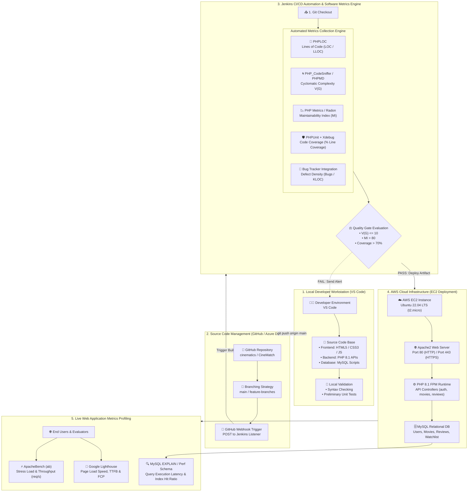
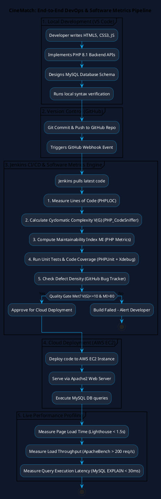

# CineMatch — End-to-End DevOps & Software Metrics Architecture Diagram Prompts

This guide provides **Mermaid.js code diagrams**, **PlantUML scripts**, **Draw.io import XML**, and **AI Prompts (ChatGPT / Midjourney / Eraser.io)** to generate presentation-grade architecture diagrams for your **Software Metrics Course Presentations**.

---

## 1. 📊 Renderable Mermaid.js Diagram Code
*Copy and paste this code directly into Markdown, Notion, GitHub, or [Mermaid Live Editor](https://mermaid.live)*

---

## 2. 🎨 AI Image Generation Prompts (Midjourney / DALL-E 3 / ChatGPT)

### Prompt A: For Photorealistic / Vector Software Architecture Infographic
> **Copy & Paste into Midjourney, ChatGPT, or DALL-E 3:**
>
> `"A modern, sleek, high-tech software architecture flowchart diagram for an Agile Movie Recommendation System named CineMatch. Dark blue background with neon cyan, gold, and white accents. Clean vector design showing 5 connected stages: 
> 1) Developer Coding in VS Code (HTML, PHP, MySQL), 
> 2) GitHub Repository with Webhook push trigger, 
> 3) Jenkins CI/CD Pipeline executing 7 Software Metrics (Lines of Code, Cyclomatic Complexity V(G), Maintainability Index, Code Coverage, Defect Density), 
> 4) AWS EC2 Cloud Infrastructure hosting Apache Web Server and MySQL Database, 
> 5) Real-time Website Performance Benchmarking (ApacheBench, Google Lighthouse, Query Speed). Professional technical infographic layout, readable typography, flat design style, highly detailed, 16:9 aspect ratio."`

---

### Prompt B: For Eraser.io / Structurizr / Diagram AI Generators
> **Copy & Paste into Eraser.io or DiagramGPT:**
>
> `"Create an end-to-end DevOps CI/CD pipeline and Software Metrics evaluation architecture diagram for 'CineMatch' with 5 sequential columns:
> Column 1: VS Code IDE (Local Development with HTML, CSS, JS, PHP 8.1, MySQL scripts).
> Column 2: Version Control System (GitHub Repository with Branching and Webhook triggers).
> Column 3: Jenkins CI/CD Metrics Server (PHPLOC for LOC, PHP_CodeSniffer for Cyclomatic Complexity, PHP Metrics for Maintainability Index, PHPUnit/Xdebug for Code Coverage, Quality Gate check).
> Column 4: AWS EC2 Cloud Host (Ubuntu 22.04 LTS, Apache Web Server, MySQL Database with B-Tree indexes).
> Column 5: Live Website Metrics Profiling (Google Lighthouse Page Speed, ApacheBench Load Throughput, MySQL EXPLAIN Query Latency).
> Use dark slate background, bright sky blue connection arrows, icon badges for each tool, and clean labels."`

---

## 3. 📄 PlantUML Diagram Script
*For VS Code PlantUML Extension or [PlantText.com](https://www.planttext.com)*

